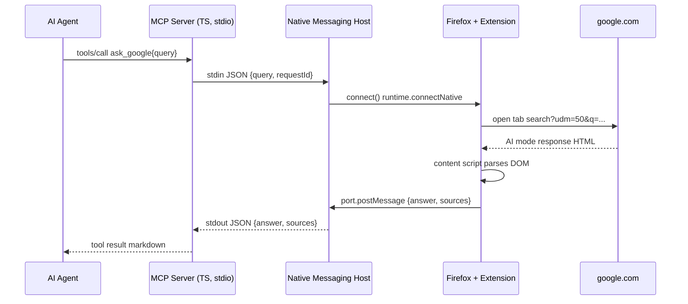

## Goal

A two-piece system that lets any MCP-compatible AI agent (Claude Code, Cursor, etc.) run Google AI Mode searches (`https://www.google.com/search?udm=50&q=<query>`) using your own already-logged-in Firefox profile, then returns the synthesized AI answer + citations to the agent as an MCP tool result.

- No headless browser, no stealth tricks, no CAPTCHA handling - your real Firefox session does the work.
- One MCP tool: `ask_google(query)`.

## Architecture



## Components

### 1. `src/` (TypeScript, package `anima-use-google`)

- `src/index.ts` - entrypoint; creates `McpServer` from `@modelcontextprotocol/sdk`, registers tool `ask_google`.
- `src/native-messaging.ts` - spawns the native messaging host binary as a child process and speaks the native-messaging framing (4-byte little-endian length prefix + UTF-8 JSON payload) over its stdin/stdout. Wraps request/response with a `requestId` and a timeout.
- Tool definition:
  - name: `ask_google`
  - input: `{ query: string, timeout_ms?: number }`
  - output: one text content block: `## AI answer\n<markdown answer>\n\n## Sources\n[1] title - url\n...`; on error, `isError: true` with a clear message.
- `package.json`: `bin` points to built `dist/index.js` so it runs via `npx`. Depends on `@modelcontextprotocol/sdk`.
- `tsconfig.json` (NodeNext, strict), `.gitignore` (dist, node_modules), `.env.example` (host binary path, timeout).
- `README.md` - install: install extension, register native messaging host manifest, `claude mcp add ask-google npx anima-use-google`.

### 2. `native-host/` (small Node script `host.js`, packaged alongside MCP binary)

- Reads framed messages from stdin, relays to the Firefox extension over a persistent `runtime.Port` (connected via `browser.runtime.connectNative` from the extension side - the host process is started by Firefox on extension connect).
- Receives tab results back over the port, writes framed replies to stdout.
- Stays alive for the MCP server's lifetime (one persistent native-messaging connection per MCP session; the MCP server actually spawns this host directly and talks framed stdio - see note below).
- Also ships a manifest generator script and the native-messaging manifest template (`native-host/manifest/com.ask.google.json.tmpl`) with platform paths for Linux/macOS/Windows.

Implementation note: native messaging in Firefox works as: the extension calls `browser.runtime.connectNative("com.ask.google")` -> Firefox spawns the host binary named in the OS manifest -> host talks framed-stdio with the extension. To let the MCP server drive it, we use a thin adapter: the MCP server's `native-messaging.ts` will spawn the SAME `host.js` as a child process directly (talk framed stdio), and `host.js` connects onward to Firefox via a tiny local unix socket / named pipe bridging the extension port. To keep v1 simple, we instead spawn `host.js` and have it bridge stdio <-> the Firefox native port. The end result: MCP server <-> `host.js` (stdio framing) <-> Firefox native messaging <-> extension.

### 3. `extension/` (Firefox WebExtension MV3)

- `manifest.json`:
  - `manifest_version: 3`, `browser_specific_settings.gecko.id` = `ask-google@anima-use-google`, `version: "0.1.0"`.
  - `permissions`: `activeTab`, `nativeMessaging` (with `native_messaging` host permission `"com.ask.google"`), `tabs`, optional `scripting`.
  - `background.scripts` / `background.service_worker` = `background.js`.
  - `content_scripts`: match `https://www.google.com/search*` and `https://www.google.com/search?*`, run `content.js` at `document_idle`.
- `background.js`:
  - On `runtime.onInstalled` / startup, call `runtime.connectNative("com.ask.google")` and hold a port.
  - Listen for messages `{ requestId, query }` on the port -> open or focus a tab to `https://www.google.com/search?udm=50&q=<encoded query>` -> inject `content.js` (via `scripting.executeScript` if MV3 allows in FF; else rely on content_scripts match) -> forward `requestId` to the tab -> await tab's `runtime.sendMessage` `{ requestId, answer, sources }` -> post it back over the native port.
- `content.js`:
  - Watches for AI Mode answer container. Uses a poll loop + `MutationObserver` with timeout (default 30s) detecting completion: presence of the AI answer block plus a stable DOM (the "thumbs up / regenerate" controls appearing is a reliable completion signal per the reference repo).
  - On completion: extract answer text (preserve paragraph breaks -> `\n\n`, lists -> markdown), extract sources (cited link titles + URLs from the AI Mode citation elements), map `[CITE-n]` placeholders to `[n]`, and `runtime.sendMessage` back to the background the `{ requestId, answer, sources }` payload.
  - Selectors will be isolated in `src/selectors.js` so they can be tuned without touching logic (Google changes these often).
- `icons/`: simple placeholder PNGs (16/48/128) - I'll create tiny valid PNGs or reference a generated asset.
- No external runtime deps; vanilla DOM. Uses `web-ext lint` for verification where possible.

## Repo layout

```
/
├── LICENSE                       (exists)
├── README.md                     (new - install + usage)
├── .gitignore                    (node_modules, dist, *.log)
├── package.json                  (workspace? no - separate)
├── mcp-server/
│   ├── package.json
│   ├── tsconfig.json
│   ├── .env.example
│   └── src/
│       ├── index.ts
│       └── native-messaging.ts
├── native-host/
│   ├── host.js
│   ├── install-host.js           (writes OS manifest to correct path)
│   └── manifest/
│       └── com.google-ai.search.json.tmpl
└── extension/
    ├── manifest.json
    ├── background.js
    ├── content.js
    ├── src/
    │   └── selectors.js
    └── icons/
        ├── icon-16.png
        ├── icon-48.png
        └── icon-128.png
```

## Verification plan

- `npm run build` in `mcp-server/` - tsc -p . succeeds, dist/index.js runnable with `node dist/index.js` (smoke: prints MCP server start log line, exits on stdin close).
- `npm run typecheck` (tsc --noEmit) clean.
- `node native-host/host.js` sanity: responds to a framed ping on stdin with a stable error when no Firefox port is connected (doesn't crash, doesn't hang).
- `web-ext lint` on `extension/` if available (check via `npx web-ext --version`); if not installed, skip with a note.
- Inspect `extension/manifest.json` valid JSON.
- Manual end-to-end test documented in README but NOT run automatically (requires your logged-in Firefox session).

## Notes / assumptions

- Chromium support deferred (later, per your ask).
- The MCP server uses stdio transport (the common case for `claude mcp add ... npx ...`).
- I will NOT publish anything, commit, or modify LICENSE.
- I'll generate tiny valid PNG icons programmatically (1x1 solid color) to satisfy manifest referencing; you can replace later.
- Selectors for AI Mode DOM are best-effort and centralized; Google's markup shifts, so the README will note where to tweak if extraction breaks.
